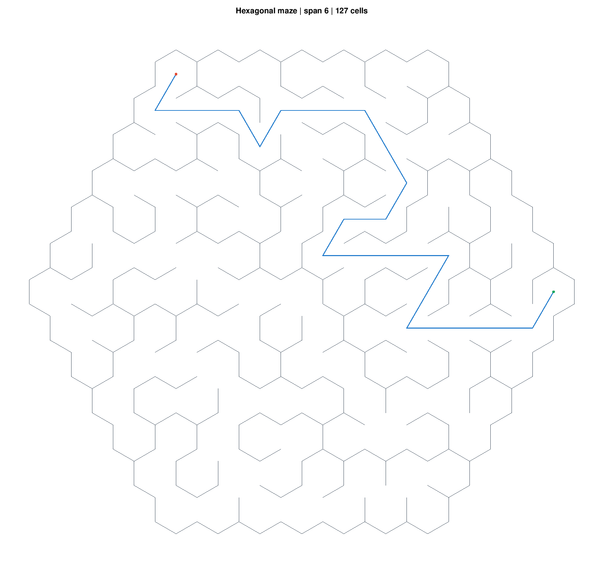
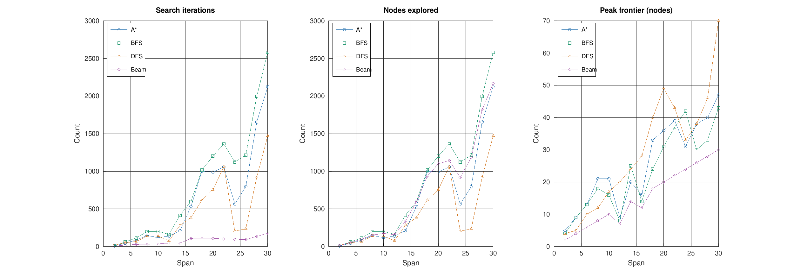

# Hexagonal Maze Solver

A MATLAB/Octave project for generating hexagonal mazes with Kruskal’s algorithm and solving them with A*, BFS, DFS, and beam search.

[Read the term paper](term_paper.pdf).



Green is the start, red is the goal, and blue is the solution.

## Run

Tested with GNU Octave 11.3.0. Run these commands from the repository root:

```sh
# Solve and display a maze
octave --persist examples/demo_maze.m

# Compare the four solvers across maze sizes
octave --persist maze_sim.m
```

To try a different size or solver, edit `examples/demo_maze.m` or use:

```matlab
rng(42);
maze = hexmaze.generateMaze(6, 1);  % number of rings, hexagon side length
[route, stats] = hexmaze.solveMaze(maze, [6, 0], [6, 12], 'astar');
hexmaze.plotMaze(maze, route, [6, 0], [6, 12]);
```

Cells are addressed as `[ring, position]`: `[0, 0]` is the center, and ring `r` has positions `0` through `6*r-1`. Solver options are `'astar'`, `'bfs'`, `'dfs'`, and `'beam'`. Beam search takes an optional fifth argument for its width and may fail to find a route.

## Comparison



All four solvers use the same maze at each size. Beam iterations count levels; the other solvers count individual nodes. Peak frontier size counts pending nodes, not total memory usage. Black crosses mark failed searches.

## Code

`+hexmaze/` contains maze generation, solvers, and plotting. `examples/` has the demo and image export scripts.

```sh
# Regenerate the images (requires a graphics toolkit; tested with gnuplot and Ghostscript)
octave --no-gui --quiet examples/export_demos.m
```
